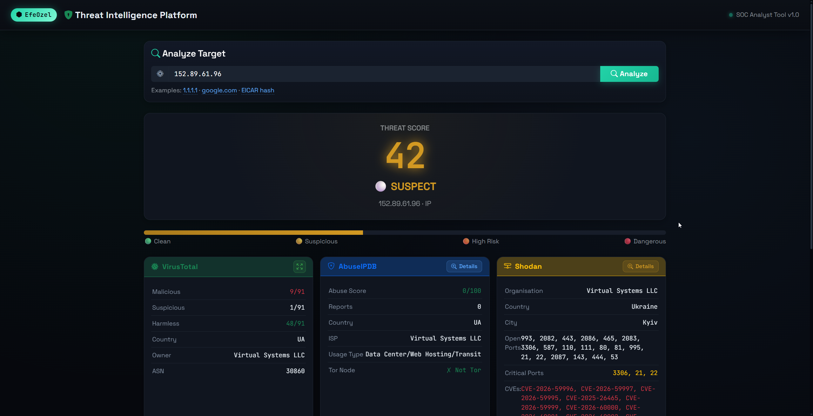
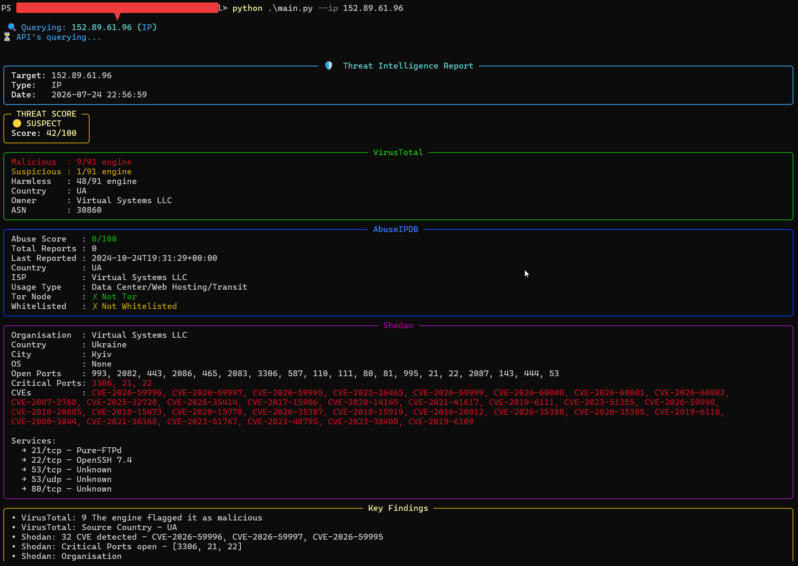
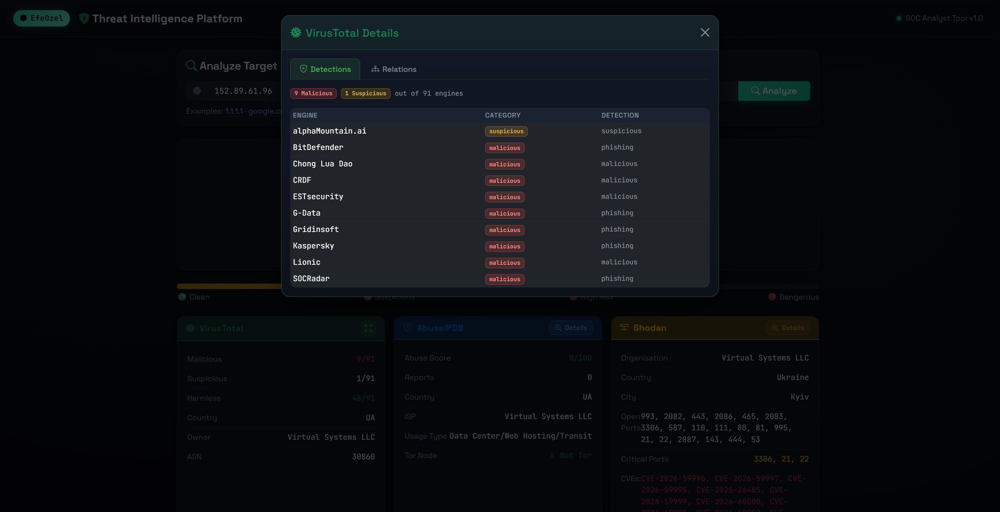

# 🛡️ Threat Intelligence Tool

> A multi-source threat intelligence platform for SOC analysts. Query IPs, domains, and file hashes across VirusTotal, AbuseIPDB, and Shodan — from both CLI and a local web dashboard.


---

## 📸 Screenshots

### Web Dashboard
<!-- Add your web dashboard screenshot here -->
> 

### CLI Output
<!-- Add your CLI output screenshot here -->
> 

### VirusTotal Detail Modal
<!-- Add your VT modal screenshot here -->
> 

---

## ✨ Features

| Feature | Description |
|---|---|
| 🔍 **Multi-source** | Queries VirusTotal, AbuseIPDB, and Shodan simultaneously |
| ⚡ **Parallel requests** | All APIs queried at the same time — results in ~2 seconds |
| 🎯 **Auto-detection** | Automatically detects if input is IP, domain, or hash |
| 📊 **Risk scoring** | Weighted scoring system with 4 threat levels |
| 🖥️ **Dual interface** | Both CLI and local web dashboard |
| 🔎 **Detail modals** | Deep-dive into detections, relations, reports, CVEs |
| 💾 **JSON reports** | Save results to timestamped JSON files |
| 🛡️ **Input validation** | Rejects private IPs, invalid formats, empty inputs |

---

## 🚀 Quick Start

### 1. Clone the repository

```bash
git clone https://github.com/efeozell/threatintel
cd threatintel
```

### 2. Install dependencies

```bash
pip install -r requirements.txt
```

### 3. Configure API keys

Create a `.env` file in the project root:

```env
VIRUSTOTAL_API_KEY=your_virustotal_key_here
ABUSEIPDB_API_KEY=your_abuseipdb_key_here
SHODAN_API_KEY=your_shodan_key_here
```

> **Get your free API keys:**
> - [VirusTotal](https://www.virustotal.com/gui/join-us) — 500 requests/day free
> - [AbuseIPDB](https://www.abuseipdb.com/register) — 1,000 requests/day free
> - [Shodan](https://account.shodan.io/register) — limited free tier

### 4. Run

```bash
# CLI mode
python main.py --ip 1.2.3.4

# Web dashboard
python main.py --web
# → Open http://127.0.0.1:5000
```

---

## 📖 Usage

### CLI Mode

```bash
# Query an IP address
python main.py --ip 185.220.xx.xx

# Query a domain
python main.py --domain malware.example.com

# Query a file hash (MD5, SHA1, SHA256)
python main.py --hash 44d88612fea8a8f36de82e1278abb02f

# Save result to JSON report
python main.py --ip 185.220.xx.xx --save

# Show help
python main.py --help
```

### Web Dashboard

```bash
python main.py --web
```

Open `http://127.0.0.1:5000` in your browser.

**Available features in the web UI:**
- Search by IP, domain, or hash
- Visual threat score with color-coded indicator
- Expandable detail modals for each data source
- VirusTotal: Engine detections table + IP/domain relations
- AbuseIPDB: Recent abuse reports + attack category breakdown
- Shodan: Full service list + CVE vulnerabilities with NVD links

---

## 🏗️ Architecture

```
threat_intel/
│
├── main.py                 ← Entry point (CLI + Web launcher)
├── config.py               ← API keys, constants, thresholds
├── .env                    ← API keys (not committed to Git)
│
├── core/
│   ├── validator.py        ← Input type detection & validation
│   ├── query_manager.py    ← Parallel API orchestration
│   └── aggregator.py       ← Score calculation & result merging
│
├── apis/
│   ├── virustotal.py       ← VirusTotal API v3
│   ├── abuseipdb.py        ← AbuseIPDB API v2
│   └── shodan_api.py       ← Shodan REST API
│
├── output/
│   ├── cli_output.py       ← Rich terminal output
│   └── report.py           ← JSON report generation
│
└── web/
    ├── app.py              ← Flask server & API endpoints
    ├── templates/
    │   └── dashboard.html  ← Single-page dashboard
    └── static/
        ├── style.css
        └── script.js
```

---

## 🔢 Scoring System

The tool calculates a weighted risk score (0–100) from all available sources:

| Source | Weight | Factors |
|---|---|---|
| VirusTotal | 40% | Malicious engine count |
| AbuseIPDB | 40% | Abuse confidence score, Tor node |
| Shodan | 20% | CVE count, critical open ports |

**Threat Levels:**

| Score | Level | Meaning |
|---|---|---|
| 0–30 | 🟢 **CLEAR** | No significant threat indicators |
| 31–60 | 🟡 **SUSPICIOUS** | Some indicators, investigate further |
| 61–80 | 🟠 **HIGH RISK** | Strong indicators, likely malicious |
| 81–100 | 🔴 **DANGEROUS** | Confirmed malicious, block immediately |

---

## 🔌 API Endpoints (Web Mode)

| Method | Endpoint | Description |
|---|---|---|
| `GET` | `/` | Web dashboard |
| `POST` | `/api/analyze` | Run full analysis |
| `POST` | `/api/vt-details` | VirusTotal relations |
| `GET` | `/api/health` | Server health check |

**Example API call:**

```bash
curl -X POST http://127.0.0.1:5000/api/analyze \
  -H "Content-Type: application/json" \
  -d '{"target": "185.220.xx.xx"}'
```

---

## 📦 Requirements

```
requests
flask
python-dotenv
colorama
rich
shodan
```

Install all:

```bash
pip install -r requirements.txt
```

`requirements.txt`:
```
requests==2.31.0
flask==3.0.0
python-dotenv==1.0.0
colorama==0.4.6
rich==13.7.0
shodan==1.31.0
```

---

## 🛡️ Supported Input Types

| Type | Examples | Sources Used |
|---|---|---|
| IPv4 | `185.220.xx.xx` | VirusTotal, AbuseIPDB, Shodan |
| IPv6 | `2001:db8::1` | VirusTotal, AbuseIPDB |
| Domain | `malware.com` | VirusTotal only |
| URL | `https://evil.com/path` | Auto-extracted → domain |
| MD5 | `44d88612...` (32 chars) | VirusTotal only |
| SHA1 | `da39a3ee...` (40 chars) | VirusTotal only |
| SHA256 | `e3b0c442...` (64 chars) | VirusTotal only |

> **Note:** Private IPs (`192.168.x.x`, `10.x.x.x`, etc.) are automatically rejected.

---

## ⚠️ Disclaimer

This tool is intended for **defensive security purposes only** — threat hunting, incident response, and SOC analyst workflows. Do not use against systems you don't own or have explicit permission to analyze.

---

## 👤 Author

**Efe Özel**
- SOC Analyst | Blue Team
- GitHub: [@efeozell](https://github.com/efeozell)
- Linkedin: [@efeozell](https://www.linkedin.com/in/efeozell/)

---
